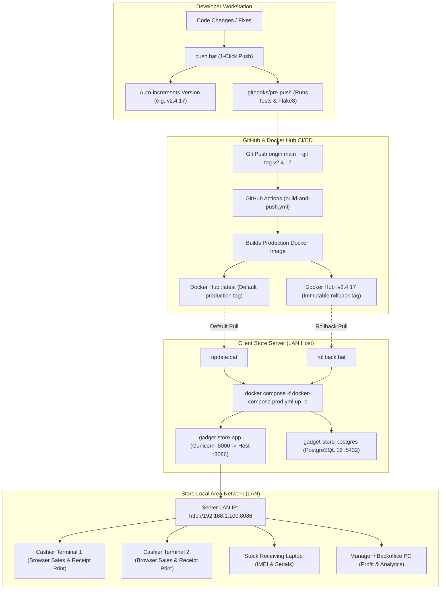

# Gadget Store Management System (Clarity Retail / 21 Void Technologies)

A production-grade, high-performance retail inventory, Point-of-Sale (POS), and operational expense management platform built with Python, Django 5, PostgreSQL 16, Tailwind CSS, and Docker, featuring automated GitHub Actions CI/CD, dual-tag Docker Hub registry management, and 1-click on-premise client updates and rollbacks.

---

## 🏗️ Architecture & Deployment Overview

The deployment pipeline connects your local developer workstation to the client store's on-premise local server via GitHub and Docker Hub:



---

## 🏷️ Docker Hub Tagging Strategy

Every release pushed to Docker Hub is tagged with **two identifiers**:

| Tag Type | Example Tag | Purpose | When Used |
| :--- | :--- | :--- | :--- |
| **Floating Latest** | `:latest` | Always points to the newest tested production release. | Standard 1-click deployments (`update.bat`). |
| **Immutable Release** | `:v2.4.17` | Permanently pinned to a specific release commit. | Version rollbacks (`rollback.bat`) and audit logs. |

---

## 🚀 1-Click Developer Workflow

### 1. Pushing Code & Releasing Updates
To push code, run automated tests, lint syntax, increment version, synchronize changelog, and trigger Docker Hub build:
```cmd
push.bat
```
This utility:
1. Prompts for release version (defaulting to next auto-calculated semver patch).
2. Prompts for release notes and records them in `FEATURE_UPDATES.txt` via `sync_version.py`.
3. Runs automated Django test suite and Flake8 linter locally before pushing.
4. Creates an annotated Git release tag (e.g. `v2.4.17`).
5. Pushes commits and tags to GitHub, triggering `.github/workflows/build-and-push.yml`.
6. Opens GitHub Actions build status in your web browser.

### 2. Installing Git Hooks
To ensure tests run automatically before every manual `git push`:
```cmd
install_git_hooks.bat
```

### 3. Generating the Client Deployment Package
To generate a self-contained client package for on-premise installation:
```cmd
deploy\package-for-client.bat
```
Generates `deploy\GadgetStore_LAN_Client_Deployment.zip` containing scripts, shortcuts, and documentation.

---

## 🖥️ Production Server Quickstart (Client Store Server)

- **Production Directory**: `C:\avail\GadgetStore\`
- **Application Port**: `http://localhost:8086` or `http://<SERVER_IP>:8086`
- **Docker Image**: `tinashemp/gadget-store-app:latest`

### 1-Click Client Management Scripts:
- **`update.bat`**: Pulls `:latest` image from Docker Hub, updates containers, runs migrations, verifies health, and displays Store LAN IP address.
- **`rollback.bat`**: Prompts for a previous tag (e.g. `v2.4.16`) and safely rolls back the container and database.
- **`fresh-install.bat`**: Clean wipe tool (requires typing `YES`) for new store servers or fresh re-initialization.
- **`create_desktop_shortcuts.bat`**: Creates Desktop browser shortcut, application launcher, updater shortcut, and configures silent background Docker boot on system startup.

---

## 🔑 User Roles & Access Control (RBAC)

The application enforces a 3-tier Role-Based Access Control hierarchy:

| Role | Permissions |
| :--- | :--- |
| **`ADMIN`** / Superuser | Full system access. Can view/create/edit/deactivate users, manage database backups, view financial profit/loss analytics, and configure system settings. |
| **`MANAGER`** | Can manage inventory, receive purchase invoices, approve stock batches, view sales and expense reports, and operate POS. |
| **`STAFF`** | Limited to Point of Sale (POS) checkouts, viewing product stock levels, and recording basic customer records. |

### Accessing User Management
- Navigate to **Sidebar $\rightarrow$ Users** (or Profile Dropdown $\rightarrow$ **User Management**).
- Accessible strictly by `ADMIN` accounts or superusers.
- Includes debounced real-time search, role filters, active status toggles, and self-lockout safeguards.

---

## ⚙️ Initial Administrator Setup

After starting the containers on a clean install:
```cmd
docker exec -it gadget-store-app python manage.py createsuperuser --settings=config.settings.docker_prod
```
Log in at `http://localhost:8086` to configure store name, branding, and initialize categories.

---

## 🔄 Routine Maintenance Commands

- **View Live Application Logs**:
  ```cmd
  docker logs -f gadget-store-app
  ```
- **Stop Server**:
  ```cmd
  docker compose -f docker-compose.prod.yml down
  ```
- **Run Automated Tests**:
  ```cmd
  run_tests.bat
  ```
- **Package for Client**:
  ```cmd
  deploy\package-for-client.bat
  ```
