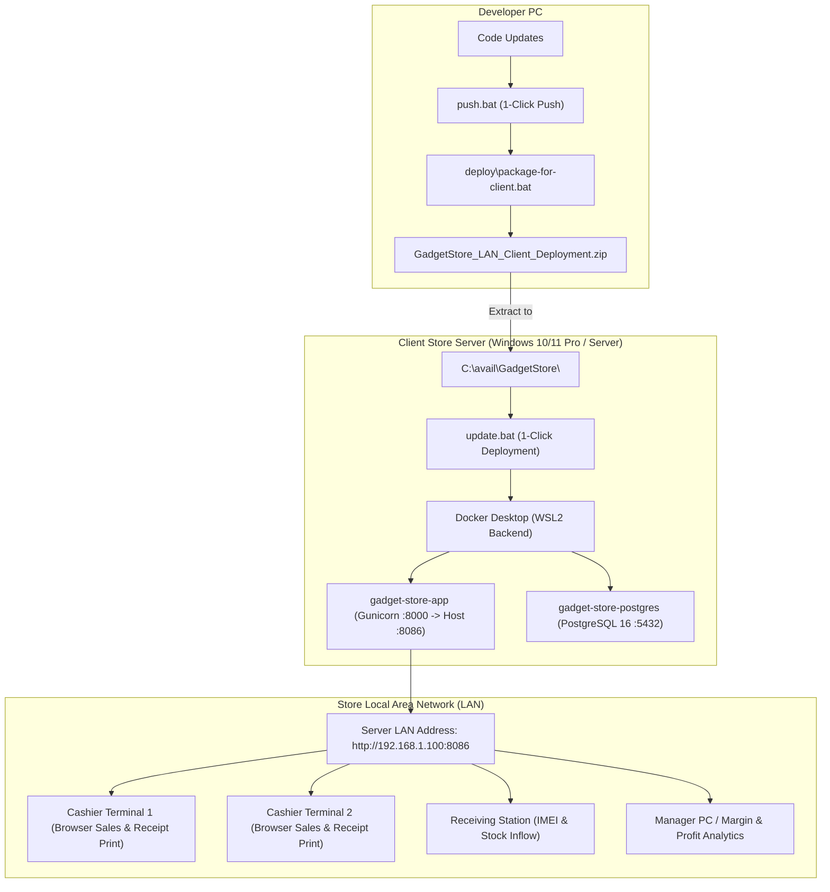

# Gadget Store System — Deployment Guide & Server Instructions

Comprehensive deployment documentation, packaging instructions, and on-premise Local Area Network (LAN) setup guide for **Gadget Store System**.

---

## 🏗️ Deployment Architecture



---

## 📦 1. Generating the Client Deployment Package (Developer PC)

To bundle deployment scripts, configuration files, shortcuts, and instructions for a client store:

1. Open a Command Prompt or double-click:
   ```cmd
   deploy\package-for-client.bat
   ```
2. The packaging utility will:
   - Prepare a clean `deploy\client-package\` directory structure (`logs/`, `media/`, `staticfiles/`, `backups/`).
   - Copy production scripts: `docker-compose.prod.yml`, `update.bat`, `rollback.bat`, `fresh-install.bat`, `create_desktop_shortcuts.bat`, `run_silent_docker.vbs`, and `.env`.
   - Bundle comprehensive setup instructions: `INSTRUCTIONS.txt`, `README.md`, and `Open Gadget Store.bat`.
   - Generate the production zip archive:
     ```text
     deploy\GadgetStore_LAN_Client_Deployment.zip
     ```

---

## 🖥️ 2. Server Installation (Client On-Premise PC)

### Prerequisites
- **OS**: Windows 10/11 Pro (64-bit) or Windows Server 2019+
- **Hardware**: Minimum 4 GB RAM, 20 GB free disk space
- **Docker Desktop**: [Download Docker Desktop](https://www.docker.com/products/docker-desktop/) with WSL2 backend enabled.

### Installation Steps
1. Copy `GadgetStore_LAN_Client_Deployment.zip` to the server machine (via USB or network share).
2. Extract the archive into:
   ```text
   C:\avail\GadgetStore\
   ```
3. Open `C:\avail\GadgetStore\.env` in Notepad and verify environment variables:
   ```ini
   DJANGO_SECRET_KEY=your-secure-random-secret-key
   POSTGRES_PASSWORD=your-secure-postgres-password
   ALLOWED_HOSTS=*
   HTTP_PORT=8086
   TAG=latest
   ```
4. Double-click **`update.bat`**:
   - Downloads the latest tested production Docker image.
   - Automatically initializes PostgreSQL and applies database migrations.
   - Outputs the server's local LAN IP address when complete.

> [!NOTE]
> If setting up an entirely new database or wiping an existing installation, run `fresh-install.bat` and type `YES` to confirm.

---

## 🚀 3. Silent Background Docker on Windows Boot

Configure Docker Desktop so it never displays an intrusive window on system startup:

### Option A: Recommended 1-Click Setup
When running `create_desktop_shortcuts.bat`, answer **`Y`** to:
```text
Would you like Docker to start completely in the background on boot? (Y/N) [Y]:
```
This adds `run_silent_docker.vbs` to the Windows Startup folder (`shell:startup`), launching Docker minimized into the system tray.

### Option B: Docker Desktop Settings
1. Open Docker Desktop $\rightarrow$ Click **Settings (Gear Icon)**.
2. Under **General**, check:
   - ☑ **Start Docker Desktop when you sign in**
   - ☑ **Open Docker Desktop in the background**
